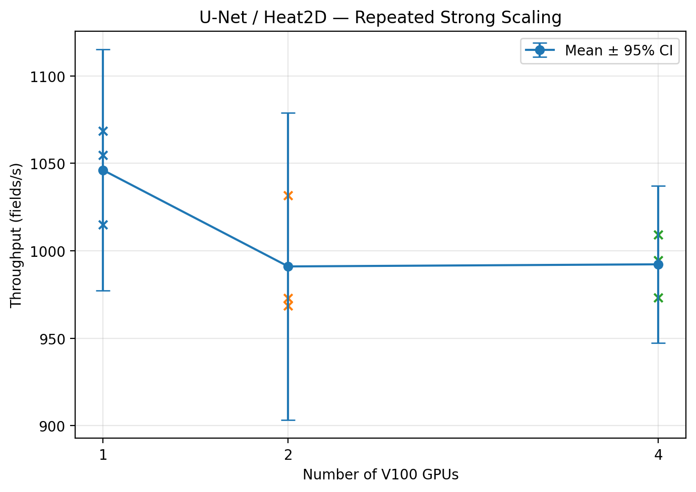

# PyTorch DDP Scaling Lab

**A multi-GPU performance study of PyTorch DistributedDataParallel (DDP), NCCL communication, strong scaling, profiling, and communication-aware optimization on NVIDIA V100 GPUs.**

The project asks one practical question:

> **When does adding GPUs actually make training faster — and what can we do when it does not?**

Two workloads show very different scaling behavior:

- **ResNet18 / CIFAR-100** — image classification
- **U-Net / Heat2D** — scientific machine-learning regression

The workflow goes beyond simply launching DDP:

```text
implement correctly
        ↓
benchmark 1 / 2 / 4 GPUs
        ↓
repeat measurements
        ↓
profile NCCL communication
        ↓
identify synchronization bottlenecks
        ↓
run controlled ablations
        ↓
optimize communication
        ↓
verify the mechanism with the profiler
```

---

## Results at a Glance

Final scaling results use **three repeated runs per configuration** on NVIDIA V100 GPUs.

| Experiment | Result |
|---|---:|
| ResNet18: 1 → 4 GPUs | **1.634× speedup** |
| ResNet18: 4-GPU scaling efficiency | **40.85%** |
| U-Net: 1 → 4 GPUs | **0.949× speedup** |
| SyncBatchNorm vs BatchNorm | **−46.35% throughput** |
| `DDP.no_sync()` optimization | **+9.67% throughput** |
| Gradient all-reduces / optimizer update | **12 → 3** |
| Gradient synchronization frequency | **−75%** |
| NCCL kernel residency | **233.5 → 150.1 ms** |
| NCCL kernel-residency reduction | **≈35.7%** |

The main lesson is:

> **More GPUs are useful only when the extra parallel compute outweighs the communication and synchronization required to coordinate them.**

---

## Why This Project?

Running a model on several GPUs is relatively easy.

Understanding **why it scales well or poorly** is much more interesting.

This project therefore focuses on the full performance-engineering loop:

- correct DDP initialization and rank handling,
- distributed data partitioning,
- gradient synchronization,
- FP16 automatic mixed precision,
- strong-scaling methodology,
- repeated benchmarking,
- PyTorch Profiler,
- NCCL collective analysis,
- BatchNorm vs SyncBatchNorm,
- gradient accumulation,
- `DDP.no_sync()`,
- Slurm-based multi-GPU execution.

For the complete methodology, theory, equations, and experiment walkthrough, see:

**[Detailed Project Report](docs/PROJECT_REPORT.md)**

---

# Strong-Scaling Experiment

Strong scaling keeps the **global batch size fixed** while increasing GPU count.

For \(N\) GPUs:

$$
B_{\text{local}}
=
\frac{B_{\text{global}}}{N}
$$

As GPU count increases, each GPU performs less local computation.

Communication still has to occur.

Eventually:

```text
useful computation per GPU ↓
communication importance  ↑
```

This is the central tradeoff studied in the project.

---

## ResNet18

ResNet18 uses a CIFAR-adapted stem and standard BatchNorm.

```text
Parameters    : 11.22 M
Dataset       : CIFAR-100
Loss          : CrossEntropyLoss
Optimizer     : SGD + momentum
Global batch  : 256
Precision     : FP16 AMP
```

### Repeated scaling results

| GPUs | Local batch | Throughput | Speedup | Efficiency |
|---:|---:|---:|---:|---:|
| 1 | 256 | **8056.89 ± 105.23 img/s** | 1.000× | 100.00% |
| 2 | 128 | **8783.87 ± 461.61 img/s** | 1.090× | 54.51% |
| 4 | 64 | **13163.49 ± 271.37 img/s** | **1.634×** | **40.85%** |


ResNet18 benefits from four GPUs, although scaling is clearly sublinear.

---

## U-Net / Heat2D

The second workload is a U-Net trained as a surrogate for a synthetic two-dimensional heat-equation problem.

```text
Parameters    : 7.70 M
Task          : physical-field regression
Loss          : MSE
Optimizer     : AdamW
Global batch  : 16
Normalization : GroupNorm
Precision     : FP16 AMP
```

GroupNorm is used deliberately so normalization statistics do not depend on the shrinking local batch size.

| GPUs | Local batch | Throughput | Speedup | Efficiency |
|---:|---:|---:|---:|---:|
| 1 | 16 | **1046.12 ± 27.76 fields/s** | 1.000× | 100.00% |
| 2 | 8 | **991.05 ± 35.32 fields/s** | 0.947× | 47.37% |
| 4 | 4 | **992.26 ± 18.12 fields/s** | **0.949×** | **23.71%** |



Here, four GPUs are slightly **slower than one GPU**.

This gives the first important systems result:

> **Distributed execution can reduce performance when local work becomes too small to amortize synchronization.**

---

# Profiling the Scaling Failure

PyTorch Profiler was used to inspect CUDA and NCCL activity for the 1-GPU and 4-GPU configurations.

Both 4-GPU workloads produced approximately:

```text
3 DDP gradient all-reduces / training step
```

Yet their scaling behavior was very different.

| Workload | GPUs | Local batch | All-reduces / step | Mean NCCL residency | Benchmark step time |
|---|---:|---:|---:|---:|---:|
| ResNet18 | 1 | 256 | 0 | 0 ms | 31.77 ms |
| ResNet18 | 4 | 64 | 3 | 11.81 ms | 19.45 ms |
| U-Net | 1 | 16 | 0 | 0 ms | 15.30 ms |
| U-Net | 4 | 4 | 3 | 7.50 ms | 16.13 ms |


The interesting result is that **ResNet18 has more absolute NCCL activity and still scales better**.

Therefore, absolute communication activity by itself does not explain scaling.

What matters is the relationship between:

```text
communication
       vs
useful local computation
       +
communication/computation overlap
```

NCCL kernel residency in this project is treated as a **diagnostic measure**, not as pure wall-clock communication overhead, because CUDA compute and communication can overlap.

---

# SyncBatchNorm Ablation

Standard BatchNorm uses statistics local to each DDP rank.

SyncBatchNorm synchronizes normalization statistics between ranks.

That additional synchronization had a large performance cost in this setup.

| Normalization | Throughput | Validation accuracy | Epoch time |
|---|---:|---:|---:|
| BatchNorm | **13163.49 ± 271.37 img/s** | 40.47% ± 2.86 pp | 3.526 s |
| SyncBatchNorm | **7061.68 ± 57.10 img/s** | 40.29% ± 3.50 pp | 6.478 s |

Measured effect:

```text
Throughput : −46.35%
Epoch time : +83.73%
```


Profiler inspection explained the mechanism.

### Standard DDP ResNet18

```text
≈ 3 gradient all-reduces / step
≈ 2 buffer broadcasts / step
```

### SyncBatchNorm ResNet18

```text
≈ 20 SyncBN forward all-gathers / step
≈ 20 SyncBN backward reductions / step
≈  3 DDP gradient all-reduces / step
≈  2 buffer broadcasts / step
```

The lesson is not that SyncBatchNorm is universally bad.

It is that:

> **Fine-grained synchronization can become expensive, and its benefit must be evaluated against its communication cost.**

---

# Communication Optimization: `DDP.no_sync()`

The U-Net was already known to be communication-limited, so it became the target for a controlled optimization experiment.

Configuration:

```text
GPUs                   : 4
Local microbatch / GPU : 4
Accumulation steps     : 4
Effective global batch : 64
```

Two gradient-accumulation strategies were compared.

### Naive accumulation

```text
microbatch 1 → backward → synchronize
microbatch 2 → backward → synchronize
microbatch 3 → backward → synchronize
microbatch 4 → backward → synchronize
                              ↓
                        optimizer.step()
```

### `DDP.no_sync()`

```text
microbatch 1 → local backward
microbatch 2 → local backward
microbatch 3 → local backward
microbatch 4 → backward + synchronize
                              ↓
                        optimizer.step()
```

Both use the same:

- effective batch size,
- model,
- data,
- optimizer,
- number of optimizer updates,
- loss scaling.

The intended difference is synchronization frequency.

---

## Optimization Results

| Mode | Throughput | Train time | Validation MSE |
|---|---:|---:|---:|
| Naive accumulation | **1071.95 ± 15.50 fields/s** | 3.831 s | 0.004677 |
| `DDP.no_sync()` | **1175.56 ± 10.87 fields/s** | 3.492 s | 0.004689 |

Result:

$$
\boxed{+9.67\% \text{ throughput}}
$$

with essentially unchanged short-run validation behavior.


---

## Profiler Verification

The profiler was then used to verify that the expected communication reduction actually occurred.

For four optimizer updates:

| Mode | Total gradient all-reduces | All-reduces / update | NCCL kernel residency |
|---|---:|---:|---:|
| Naive | **48** | **12** | **233.49 ms** |
| `no_sync()` | **12** | **3** | **150.12 ms** |

Therefore:

$$
48 \rightarrow 12
$$

corresponds to a:

$$
\boxed{75\% \text{ reduction in synchronization frequency}}
$$

and approximately:

$$
\boxed{35.7\% \text{ lower NCCL kernel residency}}
$$

The full causal chain is therefore:

```text
poor U-Net strong scaling
        ↓
NCCL/DDP profiling
        ↓
communication-limited workload identified
        ↓
avoid redundant microbatch synchronization
        ↓
48 → 12 profiler-observed all-reduces
        ↓
75% fewer gradient synchronizations
        ↓
9.67% higher measured throughput
```

---

# Distributed Training Stack

```text
Slurm
  ↓
torchrun
  ↓
one Python process per GPU
  ↓
DistributedDataParallel
  ↓
NCCL collectives
  ↓
NVIDIA V100 GPUs
```

The project includes explicit correctness checks for:

```text
process-group initialization
rank / local-rank / world-size handling
collective communication
DistributedSampler partitioning
parameter synchronization
gradient synchronization
DDP optimizer consistency
```

---

# Repository Structure

```text
pytorch-ddp-scaling-lab/
│
├── configs/                     # workload and V100 configurations
│
├── docs/
│   └── PROJECT_REPORT.md        # detailed theory + methodology
│
├── results/
│   ├── figures/
│   └── rosi_v100/
│       ├── analysis/            # initial strong-scaling analysis
│       ├── repeated_runs/       # repeated benchmark statistics
│       ├── profiling/           # NCCL profiler analysis
│       ├── syncbn/              # normalization ablation
│       └── optimization/        # no_sync experiment
│
├── scripts/
│   ├── 01_check_environment.py
│   ├── ...
│   ├── 10_train_ddp.py
│   ├── ...
│   ├── 22_profile_gradient_accumulation.py
│   │
│   └── slurm/                   # HPC job scripts
│
├── src/ddp_lab/
│   ├── data/
│   ├── models/
│   └── training/
│
├── tests/
│
├── pyproject.toml
├── requirements.txt
└── README.md
```

---

# Quick Start

Clone the repository:

```bash
git clone https://github.com/adiManethia/pytorch-ddp-scaling-lab.git
cd pytorch-ddp-scaling-lab
```

Install dependencies:

```bash
pip install -r requirements.txt
pip install -e .
```

Check the environment:

```bash
python scripts/01_check_environment.py
```

Run the synthetic ResNet model test:

```bash
python scripts/02_test_resnet.py
```

Generate and audit the Heat2D dataset:

```bash
python scripts/03_generate_heat_data.py
python scripts/04_audit_heat_data.py
```

---

# Multi-GPU Example

A four-GPU ResNet18 DDP run can be launched with:

```bash
torchrun \
    --standalone \
    --nproc-per-node=4 \
    scripts/10_train_ddp.py \
    --config configs/resnet18_v100.yaml \
    --device cuda \
    --backend nccl \
    --num-workers 2
```

HPC Slurm launch scripts for the benchmark, profiler, SyncBatchNorm ablation, and gradient-accumulation experiment are provided under:

```text
scripts/slurm/
```

---

# Benchmark Environment

Final benchmark environment:

```text
GPU       : NVIDIA Tesla V100-SXM2-32GB
GPUs/node : 4
PyTorch   : 2.10.0+cu128
CUDA      : 12.8
Backend   : NCCL
Precision : FP16 automatic mixed precision
Launcher  : torchrun
Scheduler : Slurm
```

The 1-GPU V100 result is always used as the strong-scaling baseline.

Local laptop measurements are not mixed with the final HPC scaling results.

---

# Methodology

Final throughput comparisons follow the same benchmark rules:

- fixed global batch for strong scaling,
- same model/data/optimizer across GPU counts,
- startup batches excluded from timing,
- first epoch excluded from steady-state summaries,
- throughput determined using the slowest participating rank,
- three repeated benchmark runs per final scaling configuration.

The detailed methodology and equations are documented in:

**[docs/PROJECT_REPORT.md](docs/PROJECT_REPORT.md)**

---

# Scope and Limitations

This is intentionally a controlled **single-node DDP performance study**.

It does not attempt to benchmark:

- multi-node networking,
- FSDP,
- tensor parallelism,
- pipeline parallelism,
- DeepSpeed,
- large-language-model training.

The models are small enough to fit on a single GPU; the goal is to study **data-parallel scaling and communication behavior**, not model sharding.

---

# Main Takeaway

This project started with the question:

> **Does adding GPUs automatically make training faster?**

The experiments show that the answer is **no**.

ResNet18 benefited from four V100s because enough useful computation remained to offset synchronization.

The small-batch U-Net reached its strong-scaling limit and became slightly slower.

Profiling then exposed the communication behavior, while `DDP.no_sync()` demonstrated that reducing unnecessary synchronization can recover measurable performance.

The project therefore follows a complete ML-systems workflow:

```text
implementation
    ↓
measurement
    ↓
profiling
    ↓
diagnosis
    ↓
optimization
    ↓
verification
```

---

## Detailed Documentation

For the full technical walkthrough—including DDP theory, strong-scaling equations, workload design, profiler interpretation, Slurm execution, SyncBatchNorm analysis, and gradient-accumulation methodology—see:

**[Detailed Project Report](docs/PROJECT_REPORT.md)**